# 🌱 AgriShift
### NASA-Powered Climate-Smart Agriculture Decision Support Platform

<p align="center">
  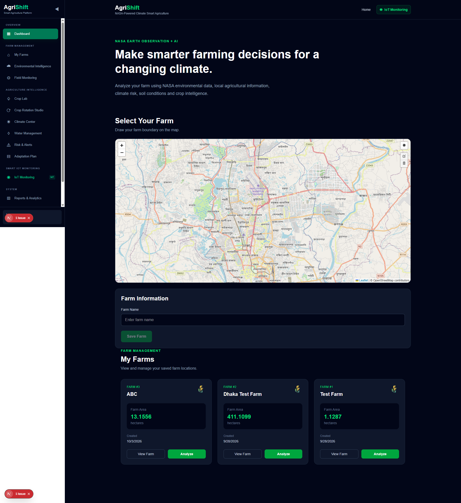
</p>

<p align="center">
  <strong>Observe • Analyze • Simulate • Recommend • Adapt</strong>
</p>

<p align="center">
  A smart agriculture platform combining NASA Earth observation, agricultural intelligence, climate analytics, and IoT-based farm monitoring.
</p>

---

## 🚀 About AgriShift

**AgriShift** is a location-aware, climate-smart agriculture decision-support platform designed to help farmers make more informed agricultural decisions using environmental data, local agricultural knowledge, and intelligent analytics.

Developed for the **NASA Space Apps Challenge 2026**, under the challenge:

**Field Shift: Adapting Farms with NASA Data**

AgriShift aims to transform complex Earth observation and agricultural datasets into practical, farm-level insights.

Farmers can select their farm, define its geographic boundary, explore environmental conditions, analyze crop suitability, investigate crop rotation strategies, understand climate risks, and explore agricultural adaptation plans.

The platform also includes an IoT monitoring interface designed for smart irrigation, soil monitoring, weather monitoring, device management, and farm automation.

### 🎯 Our Mission

To make climate and agricultural intelligence more accessible, understandable, and actionable for farmers.

---

## ❗ The Problem

Agriculture is increasingly affected by:

- Unpredictable rainfall patterns.
- Rising temperatures and heat stress.
- Soil moisture fluctuations.
- Water scarcity and irrigation challenges.
- Flooding and extreme weather events.
- Changing crop suitability and growing conditions.
- Limited access to integrated environmental information.

Although valuable environmental data is available through satellite observations and scientific datasets, farmers often lack a unified platform to understand how these factors affect their individual farms.

AgriShift addresses this information gap through farm-level environmental analysis and agricultural decision support.

---

## 💡 Our Solution

AgriShift combines multiple information sources into one agricultural intelligence platform.

### Core Workflow

```text
             FARM LOCATION
                   |
                   v
             FARM BOUNDARY
                   |
                   v
          NASA EARTH OBSERVATIONS
                   |
                   v
          LOCAL AGRICULTURAL DATA
                   |
                   v
          SPATIAL DATA PROCESSING
                   |
                   v
             ANALYTICS ENGINE
                   |
        +----------+----------+
        |          |          |
        v          v          v
    CROP       CLIMATE     SOIL & WATER
  SUITABILITY    RISK       ANALYSIS
        |          |          |
        +----------+----------+
                   |
                   v
            CROP ROTATION
                   |
                   v
         CLIMATE SIMULATION
                   |
                   v
         FARM ADAPTATION PLAN
                   |
                   v
          SMART FARM MANAGEMENT
```

---

## ✨ Key Features

### 1. Farm Management

- Interactive farm location selection.
- Geographic farm boundary drawing.
- Automatic farm area calculation.
- Farm profile management.
- Saved farm management.
- Individual farm environmental analysis.

### 2. NASA Environmental Intelligence

The platform incorporates NASA environmental information to support farm-level analysis.

Key environmental indicators include:

- Air temperature.
- Precipitation and rainfall.
- Relative humidity.
- Wind speed.
- Solar radiation.
- Soil moisture indicators.
- Vegetation condition.
- Climate trends and anomalies.

### 3. Crop Suitability Analysis

Designed to evaluate candidate crops based on environmental and agricultural conditions.

- Crop requirement analysis.
- Temperature compatibility.
- Rainfall compatibility.
- Water availability.
- Soil and moisture compatibility.
- Farmer priorities.
- Explainable crop suitability results.

### 4. Crop Rotation Studio

Explore multi-season crop rotation strategies by considering:

- Current and previous crops.
- Crop compatibility.
- Seasonal requirements.
- Water requirements.
- Soil-health objectives.
- Environmental constraints.

### 5. Climate Risk Assessment

AgriShift is designed to analyze important agricultural risks:

- Drought risk.
- Heat-stress risk.
- Flood and wetness risk.
- Water-stress risk.
- Vegetation-stress indicators.

### 6. Climate Scenario Simulator

Explore how changing temperature and precipitation conditions may influence crop suitability and farm adaptation strategies.

### 7. Smart IoT Monitoring

AgriShift includes a dedicated IoT monitoring interface with multiple modules.

- Smart Irrigation.
- Soil Monitoring.
- Weather Station.
- Crop Monitoring.
- Energy Monitoring.
- Automation & Rules.
- Alerts & Notifications.
- Device Management.
- Sensor History.

The interface is designed around an ESP32-based farm monitoring and automation architecture.

**Current status:** The IoT screens shown in this repository are demonstration interfaces using simulated readings. Physical sensor and controller integration is pending.

---

# 📸 Application Screenshots

## 1. Main Dashboard & Farm Selection

The dashboard provides an entry point for farm selection, boundary creation, and farm management.

<p align="center">
  
</p>

## 2. Farm Details & NASA Climate Profile

The farm details interface displays the selected farm boundary, farm area, agroclimatic indicators, climate risk summaries, and environmental trends.

<p align="center">
  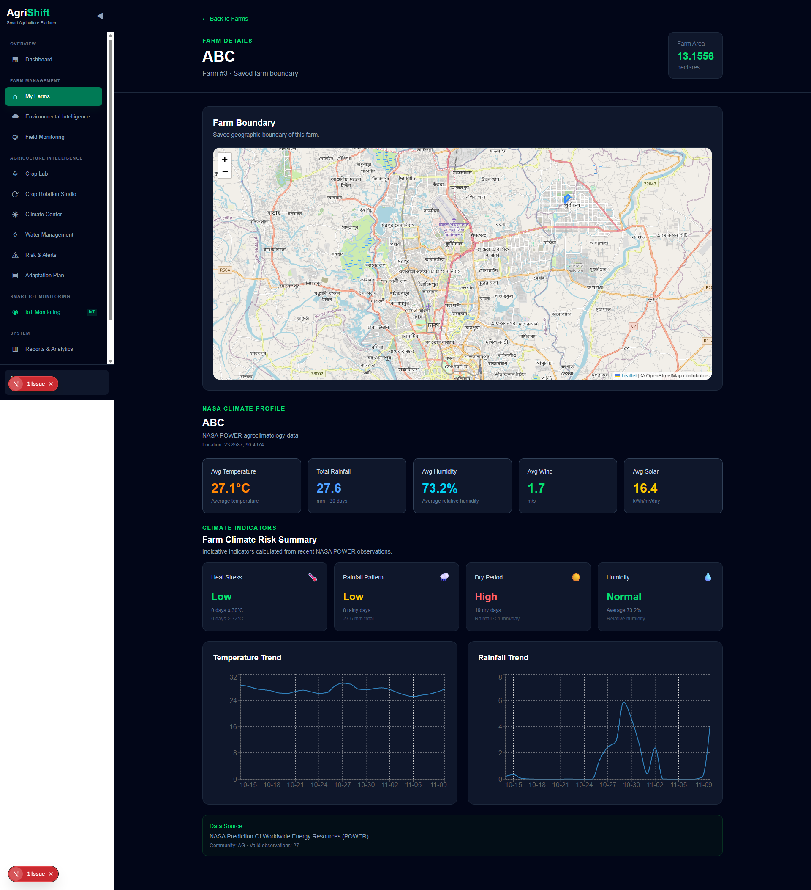
</p>

---

# 🌐 Smart IoT Monitoring System

The IoT system provides a unified interface for monitoring farm conditions and exploring automated farm-management capabilities.

## 3. IoT Overview

A centralized monitoring dashboard showing soil moisture, temperature, humidity, water tank level, device status, irrigation controls, and recent alerts.

<p align="center">
  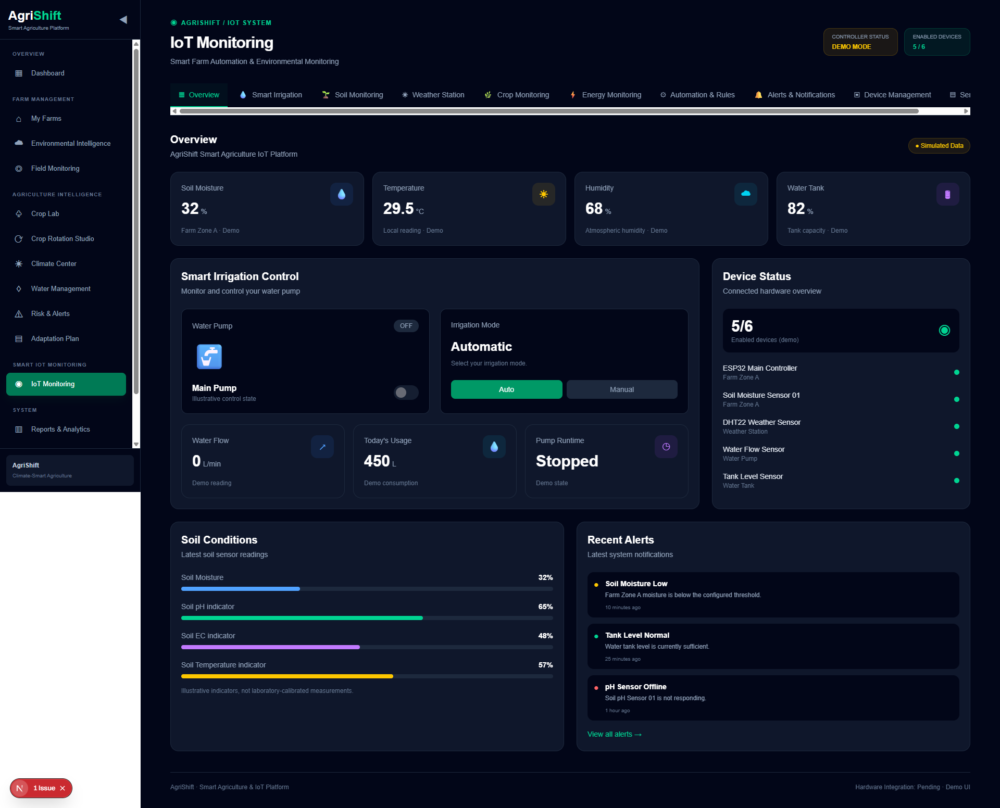
</p>

## 4. Smart Irrigation

Designed for water pump monitoring, irrigation mode selection, soil moisture thresholds, zone valve control, water tank monitoring, and water consumption tracking.

<p align="center">
  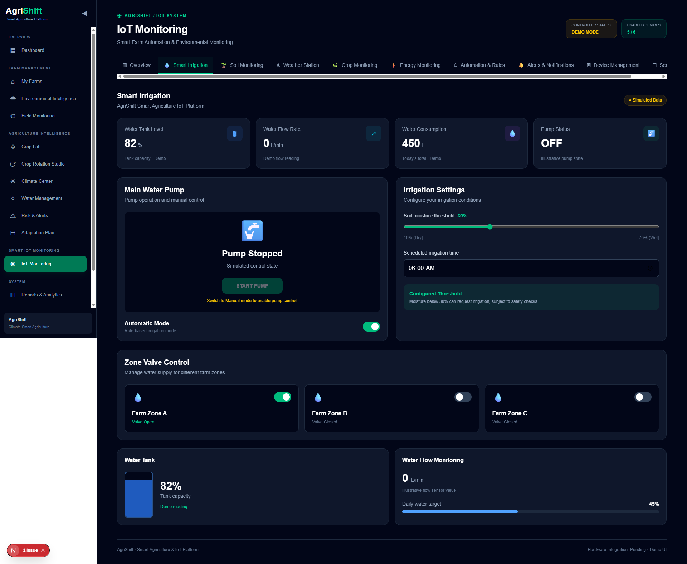
</p>

## 5. Soil Monitoring

Displays soil moisture, soil temperature, pH, electrical conductivity (EC), and illustrative NPK indicators.

<p align="center">
  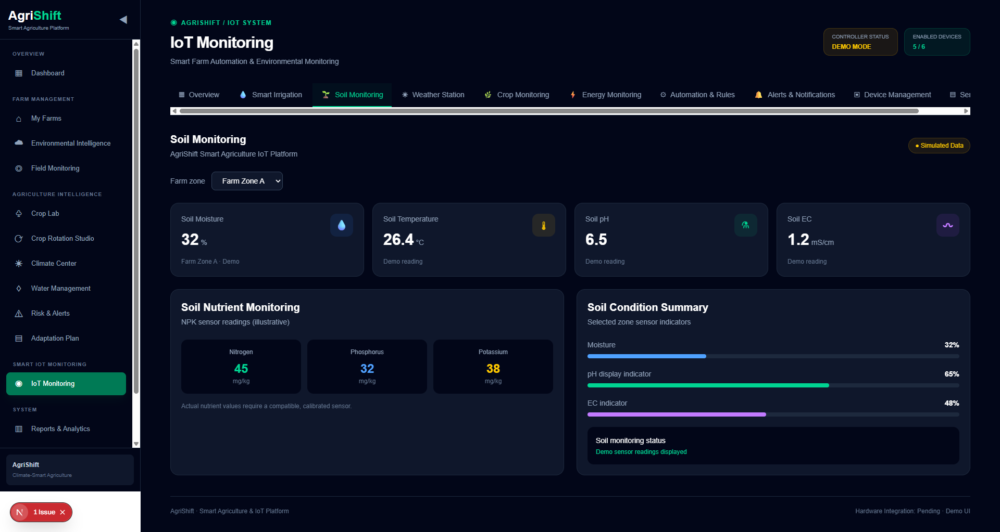
</p>

## 6. Weather Station

A weather monitoring interface displaying temperature, humidity, rainfall, wind speed, wind direction, light intensity, and additional environmental indicators.

<p align="center">
  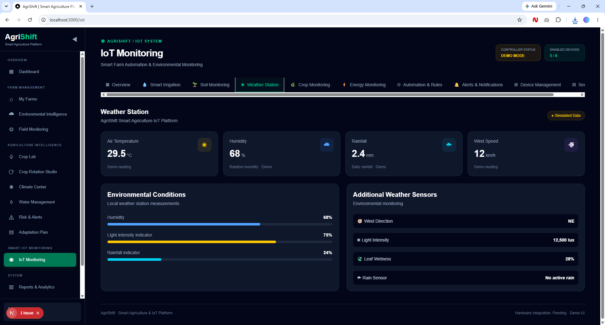
</p>

## 7. Crop Monitoring

Designed to monitor plant environmental conditions, including leaf wetness, temperature, light intensity, and future camera-based crop observation.

<p align="center">
  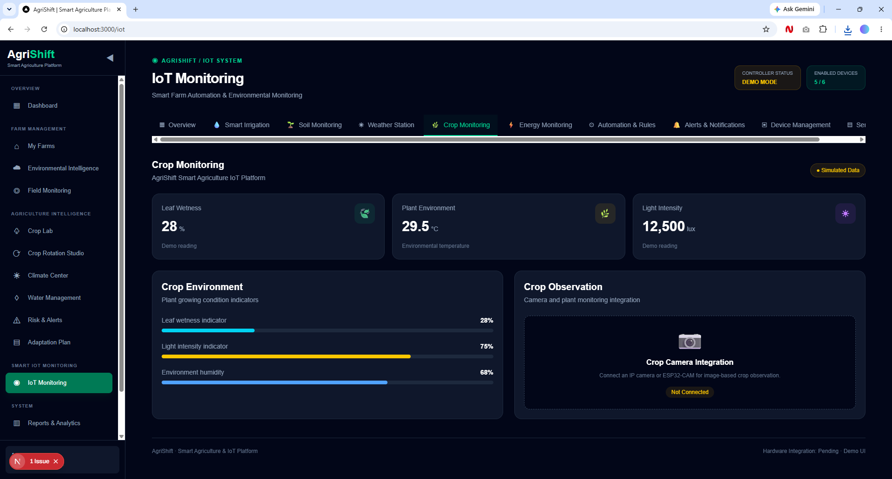
</p>

## 8. Energy Monitoring

An energy monitoring interface showing voltage, current, power consumption, energy usage, pump operating information, and planned solar monitoring integration.

<p align="center">
  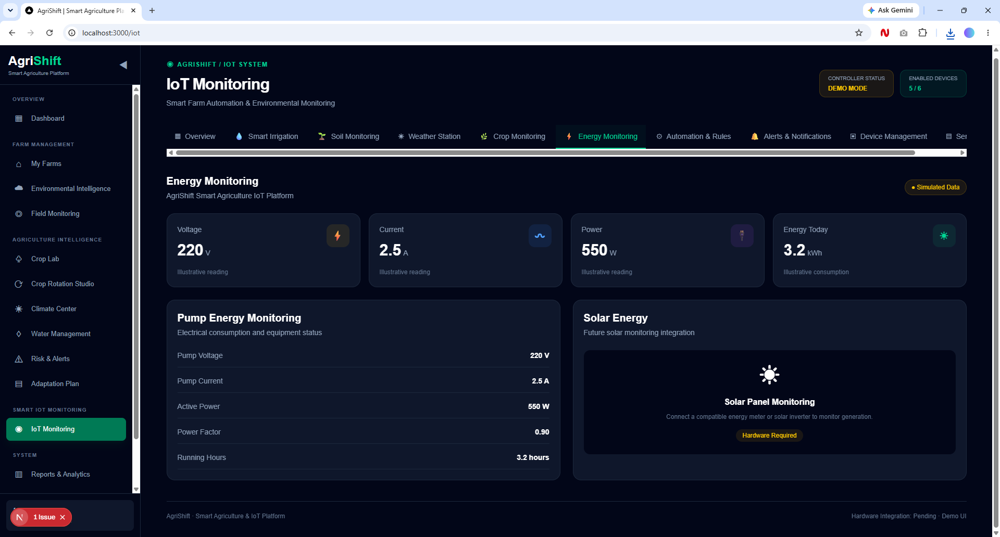
</p>

## 9. Automation & Rules

Provides a configurable interface for exploring automated farm-operation rules.

Examples include:

- Low soil moisture irrigation.
- Rain detection protection.
- Low tank protection.
- Maximum pump runtime.
- Night irrigation schedule.

<p align="center">
  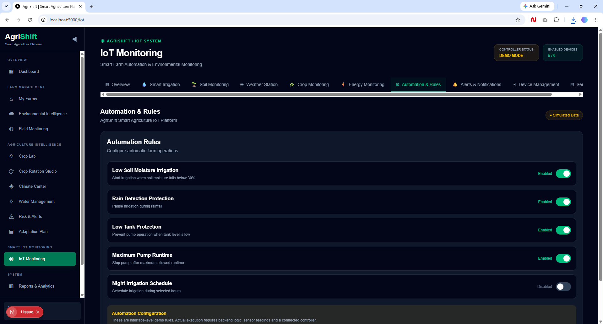
</p>

## 10. Alerts & Notifications

A centralized notification interface for monitoring sensor conditions, equipment status, and irrigation-related alerts.

<p align="center">
  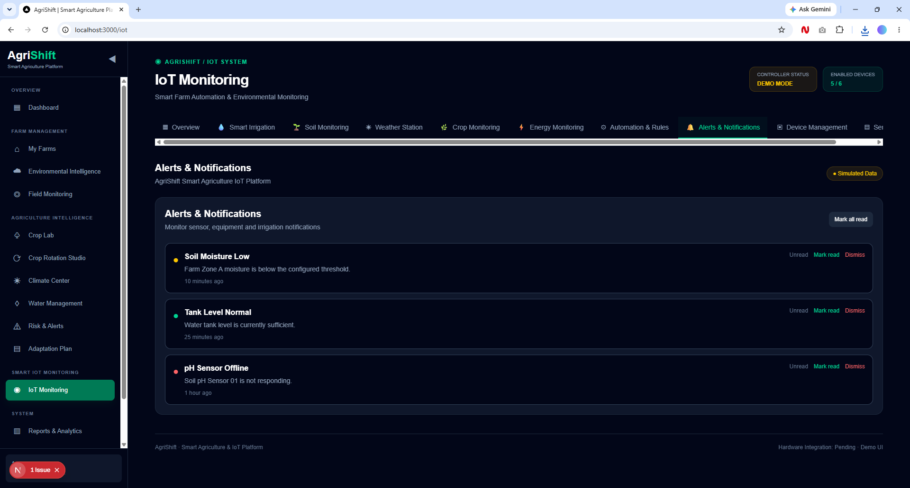
</p>

## 11. Device Management

A device management interface for viewing registered devices, device types, farm locations, connection status, and local demonstration controls.

<p align="center">
  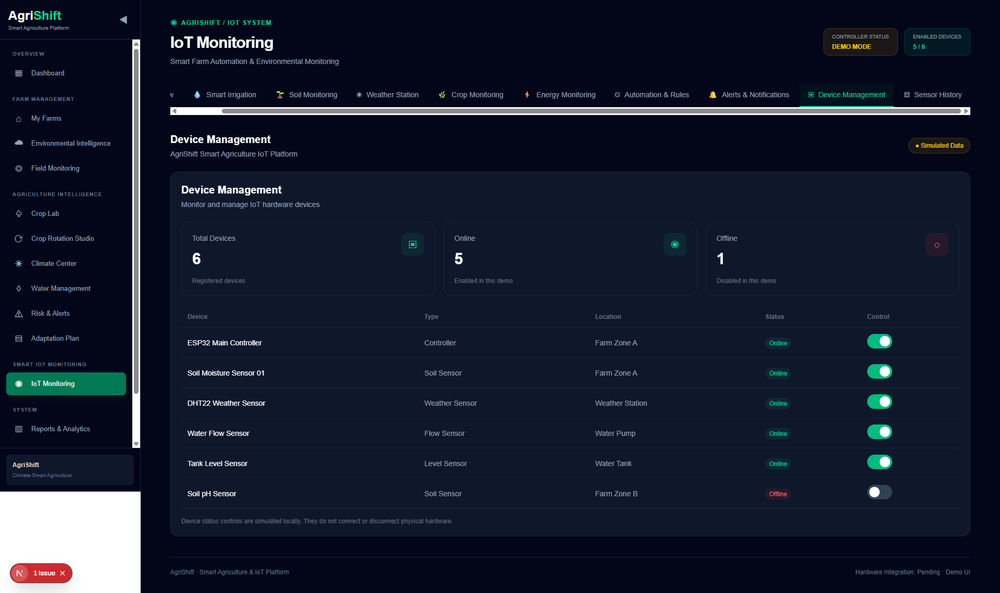
</p>

## 12. Sensor History

Displays illustrative historical sensor readings, moisture trends, temperature averages, water consumption, and example sensor records.

<p align="center">
  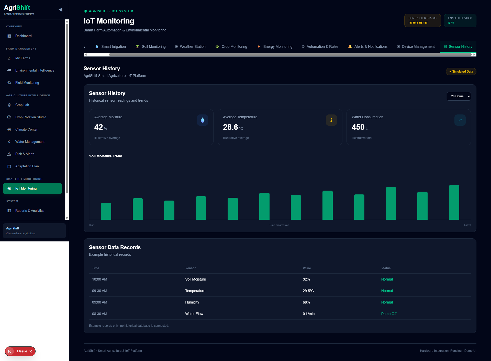
</p>

---

## 🛰️ NASA Data Sources

AgriShift's environmental data architecture is designed around the following NASA Earth observation and climate datasets.

| Dataset | Application |
|---|---|
| NASA POWER | Agroclimatic and meteorological information |
| GPM / IMERG | Precipitation and rainfall analysis |
| SMAP | Soil moisture and water-stress indicators |
| MODIS | NDVI, EVI and vegetation monitoring |
| ECOSTRESS | Land surface temperature and thermal stress |
| SWOT | Surface-water context |
| NEX-GDDP-CMIP6 | Historical and future climate projections |

### Local Agricultural Information

The platform is also designed to incorporate Bangladesh-focused agricultural information, including:

- Soil characteristics.
- Crop requirements.
- Crop calendars.
- Crop zoning.
- Farm history.
- Farmer priorities.
- Bangladesh Agricultural Research Council (BARC).
- Bangladesh Agro-Meteorological Information Service (BAMIS).

---

## 🧠 AI & Analytics Approach

AgriShift follows an explainable, data-driven analytical strategy.

The planned analytical approach includes:

1. Rule-based and weighted crop-suitability scoring.
2. Machine-learning models such as Random Forest, XGBoost, or LightGBM, depending on available training data.
3. Explainable AI using SHAP.
4. Constraint-based crop rotation optimization.
5. Climate scenario-based evaluation.

The objective is to provide understandable recommendations with supporting environmental factors rather than relying on unexplained predictions.

---

## 🏗️ System Architecture

AgriShift is designed as a modular system connecting the frontend, backend, database, environmental data processing, analytics, and farm monitoring interfaces.

```text
                    USER
                     |
                     v
              NEXT.JS FRONTEND
                     |
                     v
                FASTAPI
                  BACKEND
                     |
          +----------+----------+
          |                     |
          v                     v
     POSTGRESQL           NASA DATA
      DATABASE            SOURCES
          |                     |
          +----------+----------+
                     |
                     v
             DATA PROCESSING
                     |
                     v
             ANALYTICS ENGINE
                     |
          +----------+----------+
          |                     |
          v                     v
     AGRICULTURAL          ENVIRONMENTAL
     INTELLIGENCE            ANALYSIS
          |                     |
          +----------+----------+
                     |
                     v
             FARM INSIGHTS
                     |
          +----------+----------+
          |                     |
          v                     v
       WEB DASHBOARD       IOT MONITORING
```

---

## 🛠️ Technology Stack

| Component | Technology |
|---|---|
| Frontend Framework | Next.js |
| Frontend Library | React |
| Programming Language | TypeScript |
| Styling | Tailwind CSS |
| Backend Framework | FastAPI |
| Backend Language | Python |
| Database | PostgreSQL |
| Environmental Data | NASA Earth Observation |
| Geospatial Visualization | Interactive Map / Leaflet |
| Data Analysis | Python |
| Machine Learning | Scikit-learn / XGBoost / LightGBM (planned options) |
| IoT Architecture | ESP32 and sensor-based monitoring (planned integration) |

---

## 📁 Project Structure

```text
AgriShift/
│
├── backend/
│
├── data/
│
├── database/
│
├── docs/
│
├── frontend/
│
├── notebooks/
│
├── Photos/
│   ├── 1.png
│   ├── 2.png
│   ├── 3.png
│   ├── 4.png
│   ├── 5.png
│   ├── 6.png
│   ├── 7.png
│   ├── 8.png
│   ├── 9.png
│   ├── 10.png
│   ├── 11.png
│   └── 12.png
│
├── .gitignore
│
└── README.md
```

---

## ⚙️ Installation & Setup

### Prerequisites

Make sure you have the following installed:

- Node.js
- npm
- Python 3.10+
- PostgreSQL
- Git

### 1. Clone the Repository

```bash
git clone https://github.com/Md-Jakaria-Khalasi/AgriShift.git

cd AgriShift
```

### 2. Frontend Setup

```bash
cd frontend

npm install

npm run dev
```

Open your browser:

```text
http://localhost:3000
```

### 3. Backend Setup

Open a new terminal from the project root:

```bash
cd backend
```

Create a Python virtual environment:

```bash
python -m venv .venv
```

Activate it on Windows:

```powershell
.venv\Scripts\activate
```

Install project dependencies:

```bash
pip install -r requirements.txt
```

Configure the required environment variables and PostgreSQL database connection according to the backend configuration.

Start the FastAPI application using the actual backend entry point. For example:

```bash
uvicorn main:app --reload
```

If the backend API documentation is enabled, visit:

```text
http://127.0.0.1:8000/docs
```

---

## 🗺️ Development Roadmap

| Phase | Development Focus |
|---|---|
| Phase 01 | Project foundation and architecture |
| Phase 02 | Farm profile and boundary management |
| Phase 03 | NASA environmental data integration |
| Phase 04 | Spatial data processing |
| Phase 05 | Crop knowledge base |
| Phase 06 | Crop suitability engine |
| Phase 07 | Climate risk engine |
| Phase 08 | Crop rotation engine |
| Phase 09 | Climate scenario simulator |
| Phase 10 | Irrigation and field monitoring |
| Phase 11 | Professional dashboard and explainability |
| Phase 12 | Validation, demonstration and documentation |

---

## 🔬 Scientific Considerations

AgriShift is a decision-support platform and does not replace professional agricultural advice or laboratory testing.

- Satellite soil-moisture products do not replace laboratory soil pH and NPK tests.
- NDVI decline indicates potential vegetation stress; it does not independently confirm a particular plant disease.
- Climate projections represent scenarios under specified assumptions, not guaranteed future conditions.
- Crop suitability scores should not be interpreted as guaranteed crop yield.
- NASA datasets have different spatial and temporal resolutions, which must be considered during processing.

---

## 🌍 Expected Impact

AgriShift aims to contribute to more informed and climate-aware agriculture through:

- Better understanding of farm-level environmental conditions.
- Evidence-based crop selection.
- Climate-aware crop rotation planning.
- Improved awareness of drought, heat, and water-related risks.
- More informed irrigation and water-management decisions.
- Accessible environmental intelligence for farmers.
- Long-term climate adaptation planning.

---

## 🔗 References & Data Sources

### NASA Resources

- [NASA Earthdata](https://www.earthdata.nasa.gov/)
- [NASA POWER](https://power.larc.nasa.gov/)
- [NASA Global Precipitation Measurement (GPM)](https://gpm.nasa.gov/)
- [NASA SMAP](https://smap.jpl.nasa.gov/)
- [NASA ECOSTRESS](https://ecostress.jpl.nasa.gov/)
- [NASA SWOT](https://swot.jpl.nasa.gov/)
- [NASA NEX-GDDP-CMIP6](https://www.nccs.nasa.gov/data-collections/nex-gddp-cmip6)

### Bangladesh Agricultural Resources

- [Bangladesh Agricultural Research Council (BARC)](https://apps.barc.gov.bd/cropzoning/)
- [Bangladesh Agro-Meteorological Information Service (BAMIS)](https://www.bamis.gov.bd/)

### NASA Space Apps Challenge

- [Field Shift: Adapting Farms with NASA Data](https://www.spaceappschallenge.org/2026/challenges/field-shift-adapting-farms-with-nasa-data/)

---

## 👥 Project Information

**Project Name:** AgriShift

**Project Type:** Climate-Smart Agriculture Decision Support Platform

**Challenge:** NASA Space Apps Challenge 2026

**Challenge Theme:** Field Shift: Adapting Farms with NASA Data

**Development Focus:** NASA Earth Observation, Smart Agriculture, Climate Analytics, Crop Intelligence, and IoT Monitoring.

---

## 📄 License

This project is currently under development. An open-source license can be added before public distribution.

---

<p align="center">
  <strong>🌱 AgriShift</strong>
  <br>
  Turning Earth Observation into Smarter Agricultural Decisions.
  <br><br>
  <em>Observe. Analyze. Simulate. Recommend. Adapt.</em>
</p>